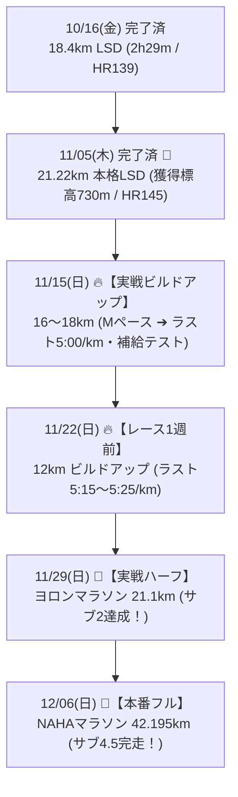

# 🔥 NAHAマラソン（サブ4.5）＆ ヨロンマラソン（サブ2）攻略：最適化トレーニング計画（完成版）

本ドキュメントは、**2026年11月29日（日）ヨロンマラソン（ハーフ：サブ2目標）** および **2026年12月06日（日）NAHAマラソン（フル：サブ4.5目標）** の達成を目指すランナーのための【心拍数低下・エコノミー特化型プログラム（完成版）】です。

ランナーの「4:08/kmを出せる高いスピードの天井」を前提に、**「長距離LSDによる心肥大・毛細血管拡張」**、**「LT走による乳酸クリアランス向上」**、そして**「ジョグ後の流しによるランニングエコノミー改善（バネ強化）」**を統合した最高密度のメニュー設計です。

---

## 🎯 ターゲットタイム
* **🔥 主目標**: **10km 50分00秒突破【サブ50達成！】**（平均 4:55〜5:00/km・想定平均心拍 175〜180bpm・実測HRmax 196bpm）
* **🏁 ヨロンマラソン（11/29 ハーフ）**: **1時間55分 〜 1時間59分【サブ2達成！】**（平均 5:27〜5:38/km・想定心拍 168〜174bpm）
* **👑 NAHAマラソン（12/06 フル）**: **4時間15分 〜 4時間30分【サブ4.5達成！】**（平均 6:00〜6:25/km・想定心拍 150〜156bpm）

---

## 🧭 心拍数を下げるための3大改善ルール（追加・強化点）

1. **【ジョグの最後に「流し（100m×2〜3本）」を常設化】（エコノミー改善）**:
   * LSDやジョグの後に、平地や緩やかな上り坂で 100m の流し（80〜90%の力で脱力・大きなフォーム）を2〜3本サッと入れます。
   * これにより筋腱のバネ（伸張反射）が目覚め、**日常のジョグや本番ペースでの酸素消費量（VO2）が減り、心拍数が自然に低下**します。
2. **【平日のLT走は「適正LTゾーン（168〜174bpm）」を管理】**:
   * 最大心拍数196bpmに合わせ、**「心拍数を 168〜174 bpm（上限目安176bpm）に収める」ことを最優先**にします。
   * 176bpmを超えそうになったら少しペースを落とすことで、乳酸を溜めずに「乳酸クリアランス酵素」を最大効率で増やします。
3. **【LSDでの「給水・補給プロトコル」の実践】（心拍ドリフト防止）**:
   * 脱水による血液濃縮（心拍数+5〜10bpmの上昇）を防ぐため、**5kmごとの給水と、10km地点でのエナジージェル摂取**を練習時からルーティン化します。

---

## 📅 週単位ロング走スタック（段階的距離ステップ）

---

## 🏃 各週の詳細スケジュール（改善版）

### Week 1：10/26（月）〜 11/01（日）【フル6週前 / ハーフ5週前】
* **テーマ**: 刺激注入完了 ＆ 遠征でのアクティブレスト
* **スケジュール**:
  * 10/26（月）: **【完了】8km ビルドアップ走**（ピッチ178spm固定・ラスト4:58/km 🔥）
  * 10/27（火）〜 28（水）: 完全休養（超回復・フェリー予約）
  * 10/29（木）夕方: **🌟【改善】6km 有酸素イージージョグ（Zone 2 / 130〜145bpm） ＋ 流し100m×2本**
    * ※ジョグ後に流しを2本入れ、翌日からの遠征前に脚のバネを刺激して整える。
  * 10/30（金）〜 11/01（日）: **遠征滞在（ラン完全オフ・積極的休養）**

---

### Week 2：11/02（月）〜 11/08（日）【フル5週前 / ハーフ4週前】
* **テーマ**: **祝日LT巡航走 ＆ 21.2km 本格ハーフ走破（有酸素エンジン爆発強化）**
* **スケジュール**:
  * 11/02（月）: 移動日（完全休養）
  * 11/03（火・祝）: **【完了】8.32km LTテンポ巡航走**（5km 5:28/km・HR171bpm・ラスト流し3:32/km 🔥）
  * 11/04（水）: 【完了】完全休養（中1日リカバリー）
  * 11/05（木）夕方: **🌟【完了】21.22km 本格LSD（2時間41分・平均心拍145bpm Zone 2死守 ＆ ラスト流し3:55/km 👑）**
    * 雨上がりの奥武山公園周回で21.22kmを走破。終始心拍145bpm前後に抑え込む驚異的なペース制御を完遂。
  * 11/06（金）〜 11/08（日）: **遠征滞在（ラン完全オフ・3日間の特大超回復）**

---

### Week 3：11/09（月）〜 11/15（日）【フル4週前 / ハーフ3週前】🔥【実戦スピード＆Mペース強化週】
* **テーマ**: **平地1kmインターバルでVO2max覚醒 ＆ フル目標巡航ペース（6:00〜6:15/km）完全定着**
* **スケジュール**:
  * 11/09（月）: **完全休養（96時間超回復の完了 ＆ 週末移動疲労リセット）**
  * 11/10（火）夕方: **【完了】🔥 10.01km 1km交代走（疾走4:38 ➔ 4:29 ➔ 最速4:20/km！つなぎ5分台、全体5:20/km・HR167・Max187）**
    * 疾走区間で想定（4:55）を圧倒する驚異のスピードと推進力を発揮。つなぎジョグでも5分台を維持し、乳酸シャトル機構とVO2maxが覚醒！動的判定【レベルA：絶好調】を達成。
  * 11/12（木）夕方: **【完了】6.35km 有酸素イージージョグ ＋ 流し**（平均7:05/km・HR144）
  * 11/13（金）: 移動日（完全休養）
  * 11/14（土）: 完全休養（ストレッチのみ）
  * 11/15（日）夕方〜夜（17:00〜18:00頃スタート推奨）: **🌟【最重要実戦走】16〜18km Mペース＋後半ビルドアップ走（フル＆ハーフ両睨み）**
    * ※午前中は降水確率80%・雷雨リスクのため、雨が上がり風が落ち着く夕方〜夜へシフト。
    * 構成: **3kmアップ（6:15〜6:30/km） ＋ 10km Mペース巡航（6:00〜6:05/km・心拍150〜156bpm） ＋ ラスト3〜5km加速（5:25/km ➔ 5:00/km前後）**
    * 補給検証: 5kmごとの電解質給水 ＋ **10km地点でのエナジージェル摂取（心拍ドリフト防止テスト）**

---

### Week 4：11/16（月）〜 11/22（日）【フル3週前 / ハーフ2週前】
* **テーマ**: **持続的LT強化 ＆ ハーフ本番ペース（5:27/km）への余裕度獲得**
* **スケジュール**:
  * 11/16（月）: 完全休養（16〜18kmビルドアップの超回復）
  * 11/17（火）夕方: **5〜6km 疲労抜きリカバリージョグ ＋ 流し100m×2本**
    * ※夕方時点で雨天の場合は無理せず **11/18（水）夕方** へスライド。
  * 11/19（木）夕方: **🔥 3kmアップ ＋ 5〜6km ガチLT閾値走（5:05〜5:15/km・心拍168〜176bpm） ＋ 1kmダウン**
    * ※涼しいコンディションと翌日から2日間オフを活かし、本番より15〜20秒速いペースを25〜30分押し切ってハーフ＆10kmサブ50の巡航力を引き上げる。
  * 11/20（金）〜 11/21（土）: 遠征滞在（ラン完全オフ・積極的休養 / 48時間超回復）
  * 11/22（日）午前または夕方: **🔥【レース1週前刺激】12km ビルドアップ走**
    * 構成: **3kmアップ（6:15〜6:30/km） ➔ 6km（5:45〜6:00/km） ➔ ラスト3km（5:15〜5:25/km）**
    * ※2日間オフ明けのフレッシュな脚にヨロン本番ペースのキレを入れ、翌週のテーパリングへ繋ぐ。

---

### Week 5：11/23（月・祝）〜 11/29（日）【ヨロンハーフ本番週 / フル1週前】
* **テーマ**: **🏁 ヨロンマラソン（21.1km）を「極上の実戦ロング走」としてサブ2完走！**
* **スケジュール**:
  * 11/23（月・祝）: 完全休養（祝日・エネルギー充填）
  * 11/24（火）夕方: **5km 調整ジョグ ＋ 流し100m×3本**
  * 11/26（木）夕方: **4km 最終刺激入れジョグ ＋ 流し100m×2本**（3kmアップ ＋ 1km 5:25〜5:30/km ＋ 流し100m×2本。前倒しで調整を完了）
  * 11/27（金）: **原則・完全休養**
    * ※翌朝移動に向けた荷造り・睡眠優先・水分・電解質補給＆カーボチャージ。
  * 11/28（土）: **🚢 与論島移動（07:00発 ➔ 11:50着）・前日完全休養**
    * ※与論到着後、前日受付・コース下見・カーボローディング・水分確保・早め就寝。
  * 11/29（日）: **🏁【ヨロンマラソン（ハーフ・21.0975km）本番】**
    * **目標タイム: 1時間55分 〜 1時間59分（サブ2達成！）**
    * 想定心拍数: **168〜174 bpm**（適正LTゾーン巡航）
    * 前半5:35/km温存 → 後半5:30/km巡航 → 余裕を持ってゴール。
    * ⚠️ 走後30分以内に糖質＋タンパク質補給、アイシング、水分補給を徹底（翌週フルへのダメージ最小化）。

---

### Week 6：11/30（月）〜 12/06（日）【NAHAマラソン本番週！】
* **テーマ**: **🎉 完全超回復からの栄光：NAHAマラソン【サブ4.5完走】！**
* **スケジュール**:
  * 11/30（月）: **🚢 与論島 ➔ 那覇移動（14:10発 ➔ 19:00着）**（完全休養・着圧ケア・水分補給）
  * 12/01（火）: 完全休養（超回復・温冷交代浴・筋膜リリース）
  * 12/02（水）夕方: **3km 超スロージョグ**（完全脱力・血流促進のみ / 脚の張りが強ければウォーキングに変更）
  * 12/04（金）夕方: **2km ジョグ ＋ 100m流し1本**（心拍を少し起こすのみ。※疲労感・筋肉痛が少しでも残っていれば**走らず完全休養**へ切り替え）
  * 12/05（土）: 完全休養（カーボローディング・水分・電解質補給）
  * 12/06（日）: **🎉【NAHAマラソン（フル・42.195km）本番】**
    * **目標タイム: 4時間15分 〜 4時間30分（サブ4.5達成！）**
    * 想定心拍数: **150〜156 bpm**（Zone 3徹底死守・30km以降も脚が止まらない！）
