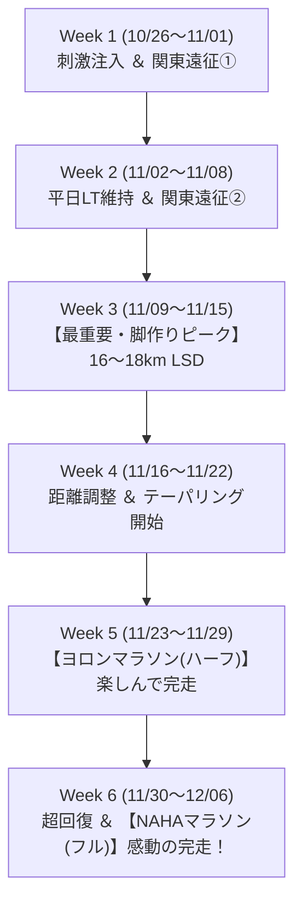

# 🏁 NAHAマラソン（2026/12/06）完走への週単位トレーニング計画

本ドキュメントは、**2026年11月29日（日）ヨロンマラソン（ハーフ）** および **2026年12月06日（日）NAHAマラソン（フル）** の完走を目指すランナーのための全6週間トレーニングロードマップです。

カレンダーから判明した**「関東遠征・滞在予定（走れない期間）」**および固有ルーティン**「最初の3kmはウォームアップ」**を完全に組み込んで設計されています。

---

## 🧭 基本方針・前提条件
1. **連戦の戦略**: ハーフ（ヨロン）の翌週にフル（NAHA）という超連戦のため、ハーフマラソンは決してタイムを追い込まず、**「心拍140〜155bpm・キロ6分半〜7分半の快適ペースで完走する、フルの最高の実戦リハーサル」**と位置づける。
2. **ルーティン遵守**: すべての走行セッションは「最初の3km＝ウォームアップ（準備）」とし、本練習は3km以降に配置する。
3. **関東滞在期間の割り切り**: 関東滞在中は無理に走らず、アクティブレスト（積極的休養・ウォーキング）として活用し、那覇在住期間に質の高い練習を集中させる。

---

## 📅 週単位ロードマップ概要（全6週間）

---

## 🏃 各週の詳細スケジュール

### Week 1：10/26（月）〜 11/01（日）【フルまで6週前 / ハーフまで5週前】
* **テーマ**: 鋭いスピード刺激注入 ＆ 関東遠征によるアクティブレスト
* **スケジュール**:
  * 10/26（月）: **【完了】8km ビルドアップ走**（Lap 7で 4:58/km 達成！🔥）
  * 10/27（火）: 完全休養（超回復）
  * 10/28（水）: 完全休養（那覇雨 60% / 与論フェリー予約日）
  * 10/29（木）: **6〜7km 有酸素イージージョグ**（3kmアップ + 3〜4km Zone 2 / 130〜145bpm）
  * 10/30（金）〜 11/01（日）: **関東滞在（ラン完全オフ・ビールフェス満喫）**

---

### Week 2：11/02（月）〜 11/08（日）【フルまで5週前 / ハーフまで4週前】
* **テーマ**: 平日集中での有酸素維持 ＆ 関東遠征②（同窓会）
* **スケジュール**:
  * 11/02（月）: 関東滞在 → 深夜22:35 那覇帰着
  * 11/03（火・祝）: **帰沖リカバリージョグ 5〜6km**（3kmアップ + 2〜3kmゆるジョグ）
  * 11/04（水）: 完全休養
  * 11/05（木）: **ポイント走：7〜8km ビルドアップ**（3kmアップ + 4km 5:25〜5:35/km巡航 + 1km流し）
  * 11/06（金）〜 11/08（日）: **関東滞在（ラン完全オフ・ちゃんぷる〜フェス＆同窓会）**

---

### Week 3：11/09（月）〜 11/15（日）【フルまで4週前 / ハーフまで3週前】
* **テーマ**: 🔥 **【最重要強化週】NAHAフル完走のための「最長距離LSD」**
* ※この週は週末に関東滞在がなく、那覇でじっくり時間を確保できる絶好のタイミング！
* **スケジュール**:
  * 11/09（月）: 完全休養
  * 11/10（火）: **7〜8km イージージョグ**（3kmアップ + 4〜5km Zone 2）
  * 11/12（木）: **6〜7km テンポ走**（3kmアップ + 3〜4km 5:15〜5:25/km巡航）
  * 11/13（金）: 東京日帰り（移動日・完全休養）
  * 11/14（土）: 軽めストレッチ・完全休養
  * 11/15（日）: **🌟【最重要ポイント走】16〜18km LSD（時間耐久走 2時間15分〜2時間30分）**
    * ペース目安: 7:45〜8:15/km（10/16の18.4km同様、Zone 2: 130〜145bpm を死守）
    * 目的: フルマラソンの後半を支える毛細血管網の拡張と、脚の筋持久力の最終土台作り。

---

### Week 4：11/16（月）〜 11/22（日）【フルまで3週前 / ハーフまで2週前】
* **テーマ**: 距離を落としながら筋力・キレを研ぐ（テーパリング開始）
* **スケジュール**:
  * 11/16（月）: 完全休養（LSDの疲労抜き）
  * 11/17（火）: **5〜6km 疲労抜きリカバリージョグ**
  * 11/19（木）: **7〜8km 軽快ビルドアップ**（3kmアップ + 3〜4km 5:20/km + 1kmダウン）
  * 11/20（金）〜 11/21（土）: 関東滞在（ラン完全オフ・土曜夜帰沖）
  * 11/22（日）: **8〜10km イージージョグ**（3kmアップ + 5〜7km 気持ちいいペース）

---

### Week 5：11/23（月・祝）〜 11/29（日）【ヨロンハーフ本番週 / フルまで1週前】
* **テーマ**: ヨロンマラソン完走 ＝ **NAHAフルマラソン最高のリハーサル**
* **スケジュール**:
  * 11/23（月・祝）: 完全休養（那覇こども大綱挽まつり）
  * 11/24（火）: **5km 調整ジョグ + 流し2本**（3kmアップ + 2km軽快走）
  * 11/26（木）: **3〜4km 超軽め刺激**（3kmアップのみで脚の軽さを確認）
  * 11/27（金）: ヨロン組来沖・移動準備
  * 11/28（土）: 完全休養（前日受付・リラックス）
  * 11/29（日）: **🏁【ヨロンマラソン（ハーフ・21.0975km）】**
    * ⚠️ **絶対ルール**: 翌週にフルがあるため、追い込み禁止！
    * 設定ペース: 6:35〜7:15/km（心拍140〜155bpm目安）
    * 目安タイム: 2時間20分〜2時間35分
    * 目的: 与論島の絶景と温かい応援を味わいながら、フルの「前半21kmの通過リハーサル」として優雅に完走する。

---

### Week 6：11/30（月）〜 12/06（日）【NAHAマラソン本番週！】
* **テーマ**: 完全超回復 ＆ 42.195km笑顔の完走！
* **スケジュール**:
  * 11/30（月）: 完全休養（ヨロンからの帰還・温冷交代浴）
  * 12/01（火）: 完全休養（ストレッチのみ）
  * 12/02（水）: **3〜4km 超スロージョグ**（脚の張りを確認・血流促進）
  * 12/04（金）: **2〜3km 刺激入れ**（3kmアップ程度 + 100m流し1本）
  * 12/05（土）: 完全休養（ゼッケン受け取り・カーボローディング・水分補給）
  * 12/06（日）: **🎉【NAHAマラソン（フル・42.195km）本番】**
    * 目標: 5時間15分〜5時間45分で笑顔で完走！
    * レース戦略: 最初の3kmは周りの喧騒に流されずウォーミングアップ（7:30〜8:00/km）。体が温まる5km以降、平和祈念公園の上り坂は無理せず心拍150bpm未満を維持し、後半の南浜・小禄の下りと大応援を力に変えてゴールへ！
