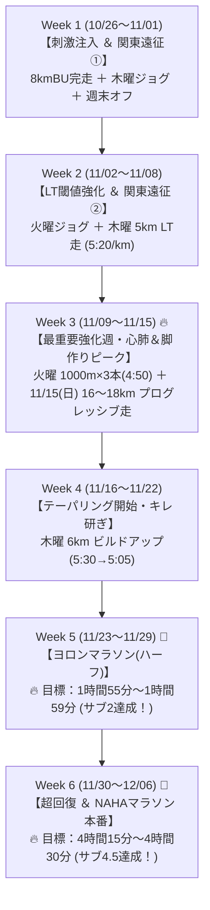

# 🔥 NAHAマラソン（サブ4.5）＆ ヨロンマラソン（サブ2）攻略：攻めの全6週間トレーニング計画

本ドキュメントは、**2026年11月29日（日）ヨロンマラソン（ハーフ：サブ2目標）** および **2026年12月06日（日）NAHAマラソン（フル：サブ4.5目標）** の達成を目指すランナーのための【攻めのハイパフォーマンス・トレーニング計画】です。

カレンダーから判明した**「関東遠征・滞在予定（走れない期間）」**および固有ルーティン**「最初の3kmはウォームアップ」**を完全に組み込んで設計されています。

---

## 🎯 攻めのターゲットタイム
* **🏁 ヨロンマラソン（11/29 ハーフ）**: **1時間55分 〜 1時間59分【サブ2達成！】**（平均ペース 5:27〜5:38/km）
* **👑 NAHAマラソン（12/06 フル）**: **4時間15分 〜 4時間30分【サブ4.5達成！】**（平均ペース 6:00〜6:25/km）

---

## 🧭 基本方針・戦略
1. **攻めのハイパフォーマンス方針**:
   * 単なる完走にとどまらず、平日の高密度LT走（乳酸閾値走）・クルーズインターバル、週末のプログレッシブ走によってスピード持久力と有酸素エコノミーを徹底強化。
2. **ルーティン遵守**:
   * すべての走行セッションは「最初の3km＝ウォームアップ（準備）」とし、本練習は3km以降に配置して怪我のリスクを完全に抑え込む。
3. **関東滞在期間の割り切り（アクティブレスト）**:
   * 関東滞在中は無理に走らず、アクティブレスト（積極的休養・ウォーキング）として割り切り、那覇在住期間に質の高い練習を集中させる。
4. **ハーフ後の超高速リカバリー**:
   * ヨロンでサブ2を獲った後、翌週NAHAフルまでの1週間は徹底的なアイシング・温冷交代浴・プロテイン・アミノ酸補給と軽ジョグに徹し、超回復状態でNAHAフルのスタートラインに立つ。

---

## 📅 週単位ロードマップ概要（全6週間）

---

## 🏃 各週の詳細スケジュール

### Week 1：10/26（月）〜 11/01（日）【フルまで6週前 / ハーフまで5週前】
* **テーマ**: 鋭いスピード刺激注入 ＆ 関東遠征によるアクティブレスト
* **スケジュール**:
  * 10/26（月）: **【完了】8km ビルドアップ走**（Lap 7で 4:58/km 達成！ピッチ178spm固定 🔥）
  * 10/27（火）: 完全休養（超回復）
  * 10/28（水）: 完全休養（那覇雨 60% / 与論フェリー予約日）
  * 10/29（木）: **6〜7km 有酸素イージージョグ**（3kmアップ + 3〜4km Zone 2 / 130〜145bpm）
  * 10/30（金）〜 11/01（日）: **関東滞在（ラン完全オフ・ビールフェス満喫）**

---

### Week 2：11/02（月）〜 11/08（日）【フルまで5週前 / ハーフまで4週前】
* **テーマ**: **【LT閾値向上】キロ5分20秒の巡航力定着 ＆ 関東遠征②**
* **スケジュール**:
  * 11/02（月）: 関東滞在 → 深夜22:35 那覇帰着
  * 11/03（火・祝）: **帰沖リカバリージョグ 5〜6km**（3kmアップ + 2〜3kmゆるジョグ）
  * 11/04（水）: 完全休養
  * 11/05（木）: **🔥【ポイント走】3kmアップ ＋ 5km LT走（5:15〜5:25/km巡航） ＋ 1kmダウン（計9km）**
    * 狙い: 乳酸蓄積を防ぎ、ハーフ5:30/kmが「楽」に感じられる有酸素エンジンを構築。
  * 11/06（金）〜 11/08（日）: **関東滞在（ラン完全オフ・ちゃんぷる〜フェス＆同窓会）**

---

### Week 3：11/09（月）〜 11/15（日）【フルまで4週前 / ハーフまで3週前】
* **テーマ**: 🔥 **【最重要強化週】VO2max（心肺上限）突破 ＆ プログレッシブ・ロング走**
* ※この週は週末に関東遠征がなく、那覇で最重要負荷をかけられる天王山！
* **スケジュール**:
  * 11/09（月）: 完全休養
  * 11/10（火）: **⚡【スピード強化】3kmアップ ＋ 1000m×3本（4:45〜4:55/km、つなぎ200mジョグ） ＋ 1kmダウン（計7km）**
    * 狙い: 心肺のポンプ機能を最大化し、心拍180bpm超での高出力エコノミーを養成。
  * 11/12（木）: **6km 有酸素イージージョグ**（3kmアップ + 3km Zone 2）
  * 11/13（金）: 東京日帰り（移動日・完全休養）
  * 11/14（土）: 軽めストレッチ・完全休養
  * 11/15（日）: **🌟【最重要ポイント走】16〜18km プログレッシブ（段階加速）ロング走**
    * 構成: 3kmアップ ＋ 8km 有酸素走（7:15〜7:45/km） ＋ **後半5〜6kmをMペース（6:00〜6:15/km）へビルドアップ！**
    * 狙い: 疲労した脚でフルの巡航ペース（6分前半）を維持する実戦的筋持久力を叩き込む。

---

### Week 4：11/16（月）〜 11/22（日）【フルまで3週前 / ハーフまで2週前】
* **テーマ**: 距離を落としてキレを研ぐ（テーパリング開始）
* **スケジュール**:
  * 11/16（月）: 完全休養（ロング走の疲労抜き）
  * 11/17（火）: **5〜6km 疲労抜きリカバリージョグ**
  * 11/19（木）: **🔥 3kmアップ ＋ 6km ビルドアップ（5:30→5:05/km） ＋ 1kmダウン（計10km）**
  * 11/20（金）〜 11/21（土）: 関東滞在（ラン完全オフ・土曜夜帰沖）
  * 11/22（日）: **8km 快調走**（3kmアップ + 5km 5:45〜6:00/km）

---

### Week 5：11/23（月・祝）〜 11/29（日）【ヨロンハーフ本番週 / フルまで1週前】
* **テーマ**: **🏁 ヨロンマラソンで【サブ2（1時間55分〜1時間59分）】奪取！**
* **スケジュール**:
  * 11/23（月・祝）: 完全休養（那覇こども大綱挽まつり）
  * 11/24（火）: **5km 調整ジョグ ＋ 流し3本**（3kmアップ + 2km軽快走）
  * 11/26（木）: **3kmアップ ＋ 1kmだけレースペース（5:30/km）確認**
  * 11/27（金）〜 28（土）: ヨロン組来沖・与論島へ移動・リラックス
  * 11/29（日）: **🏁【ヨロンマラソン（ハーフ・21.0975km）本番】**
    * **目標タイム: 1時間55分 〜 1時間59分（サブ2達成！）**
    * ペース配分: 0〜3km（5:45〜6:00/km）→ 4〜18km（5:30〜5:35/km イーブン巡航）→ ラスト3km（5:15〜5:20/km スパート！）
    * ⚠️ **走後即ケア**: ゴール直後にアイシング、30分以内にプロテイン・クエン酸・糖質補給、宿で温冷交代浴。

---

### Week 6：11/30（月）〜 12/06（日）【NAHAマラソン本番週！】
* **テーマ**: **🎉 超回復からの大金星：NAHAマラソン【サブ4.5（4時間15分〜4時間30分）】！**
* **スケジュール**:
  * 11/30（月）〜 12/01（火）: 完全休養（ヨロンからの帰還・温冷交代浴・筋膜リリース）
  * 12/02（水）: **3km 超スロージョグ**（完全脱力・脚の軽さを確認）
  * 12/04（金）: **2km ジョグ ＋ 100m流し1本**（心拍を少し起こすのみ）
  * 12/05（土）: 完全休養（カーボローディング・水分・電解質補給）
  * 12/06（日）: **🎉【NAHAマラソン（フル・42.195km）本番】**
    * **目標タイム: 4時間15分 〜 4時間30分（サブ4.5達成！）**
    * ペース戦略:
      * 0〜3km: 7:30〜8:00/km（混雑を味方につけて超省エネ）
      * 4〜20km: 6:00〜6:15/km（南部の坂道は心拍155bpm未満キープ）
      * 21〜35km: 6:10〜6:25/km（ヨロンハーフの自信を胸に省エネ巡航）
      * 35〜42.195km: 6:00〜6:15/km（残りエネルギーを解放し奥武山公園へ歓喜のゴール！）
