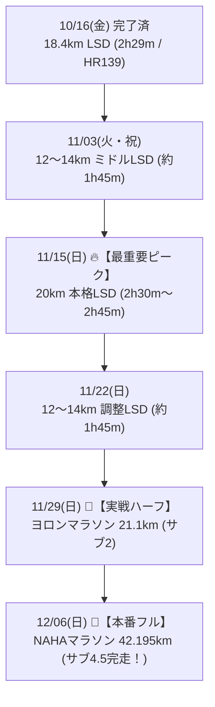

# 🔥 NAHAマラソン（サブ4.5）＆ ヨロンマラソン（サブ2）攻略：最適化トレーニング計画（完成版）

本ドキュメントは、**2026年11月29日（日）ヨロンマラソン（ハーフ：サブ2目標）** および **2026年12月06日（日）NAHAマラソン（フル：サブ4.5目標）** の達成を目指すランナーのための【心拍数低下・エコノミー特化型プログラム（完成版）】です。

ランナーの「4:08/kmを出せる高いスピードの天井」を前提に、**「長距離LSDによる心肥大・毛細血管拡張」**、**「LT走による乳酸クリアランス向上」**、そして**「ジョグ後の流しによるランニングエコノミー改善（バネ強化）」**を統合した最高密度のメニュー設計です。

---

## 🎯 ターゲットタイム
* **🏁 ヨロンマラソン（11/29 ハーフ）**: **1時間55分 〜 1時間59分【サブ2達成！】**（平均 5:27〜5:38/km・想定心拍 166〜170bpm）
* **👑 NAHAマラソン（12/06 フル）**: **4時間15分 〜 4時間30分【サブ4.5達成！】**（平均 6:00〜6:25/km・想定心拍 150〜156bpm）

---

## 🧭 心拍数を下げるための3大改善ルール（追加・強化点）

1. **【ジョグの最後に「流し（100m×2〜3本）」を常設化】（エコノミー改善）**:
   * LSDやジョグの後に、平地や緩やかな上り坂で 100m の流し（80〜90%の力で脱力・大きなフォーム）を2〜3本サッと入れます。
   * これにより筋腱のバネ（伸張反射）が目覚め、**日常のジョグや本番ペースでの酸素消費量（VO2）が減り、心拍数が自然に低下**します。
2. **【平日のLT走は「心拍数キャップ制（上限172bpm）」を導入】**:
   * ペース（5:25〜5:35/km）に固執せず、**「心拍数を 165〜172 bpm に収める」ことを最優先**にします。
   * 心拍が172bpmを超えたら少しペースを落とすことで、乳酸を溜めずに「乳酸再利用酵素」を最大効率で増やします。
3. **【LSDでの「給水・補給プロトコル」の実践】（心拍ドリフト防止）**:
   * 脱水による血液濃縮（心拍数+5〜10bpmの上昇）を防ぐため、**5kmごとの給水と、10km地点でのエナジージェル摂取**を練習時からルーティン化します。

---

## 📅 週単位ロング走スタック（段階的距離ステップ）

---

## 🏃 各週の詳細スケジュール（改善版）

### Week 1：10/26（月）〜 11/01（日）【フル6週前 / ハーフ5週前】
* **テーマ**: 刺激注入完了 ＆ 遠征でのアクティブレスト
* **スケジュール**:
  * 10/26（月）: **【完了】8km ビルドアップ走**（ピッチ178spm固定・ラスト4:58/km 🔥）
  * 10/27（火）〜 28（水）: 完全休養（超回復・フェリー予約）
  * 10/29（木）夕方: **🌟【改善】6km 有酸素イージージョグ（Zone 2 / 130〜145bpm） ＋ 流し100m×2本**
    * ※ジョグ後に流しを2本入れ、翌日からの遠征前に脚のバネを刺激して整える。
  * 10/30（金）〜 11/01（日）: **遠征滞在（ラン完全オフ・積極的休養）**

---

### Week 2：11/02（月）〜 11/08（日）【フル5週前 / ハーフ4週前】
* **テーマ**: **祝日LT巡航走 ＆ 21.2km 本格ハーフ走破（有酸素エンジン爆発強化）**
* **スケジュール**:
  * 11/02（月）: 移動日（完全休養）
  * 11/03（火・祝）: **【完了】8.32km LTテンポ巡航走**（5km 5:28/km・HR171bpm・ラスト流し3:32/km 🔥）
  * 11/04（水）: 【完了】完全休養（中1日リカバリー）
  * 11/05（木）夕方: **🌟【完了】21.22km 本格LSD（2時間41分・平均心拍145bpm Zone 2死守 ＆ ラスト流し3:55/km 👑）**
    * 雨上がりの奥武山公園周回で獲得標高730mの起伏を走破。上り坂でも心拍146bpmに抑え込む驚異的なペース制御を完遂。
  * 11/06（金）〜 11/08（日）: **遠征滞在（ラン完全オフ・3日間の特大超回復）**

---

### Week 3：11/09（月）〜 11/15（日）【フル4週前 / ハーフ3週前】🔥【最重要脚作り週】
* **テーマ**: **NAHAフル完走を決定づける「20km LSD（最長距離ピーク）」**
* ※移動のない週末、じっくり時間を確保できる最大の山場！
* **スケジュール**:
  * 11/09（月）: 完全休養
  * 11/10（火）夕方: **3kmアップ ＋ 坂道ヒルリピート（緩やかな坂ダッシュ 100〜150m×5〜6本 / 下り歩きジョグ） ＋ 2kmダウン**（着地衝撃を抑えて怪我を防ぎつつ大臀筋覚醒＆ストライド伸長）
  * 11/12（木）夕方: **5〜6km 有酸素イージージョグ ＋ 流し2本**
  * 11/13（金）: 移動日（完全休養）
  * 11/14（土）: 完全休養（ストレッチのみ）
  * 11/15（日）早朝: **🌟【最重要ポイント走】20km LSD（時間耐久 2時間30分〜2時間45分）**
    * ペース目安: **7:30〜8:00/km（心拍130〜145bpm Zone 2を徹底死守）**
    * 補給練習: 5kmごとの給水 ＋ 10km・15km地点でのエナジージェル摂取を実戦シミュレーション。

---

### Week 4：11/16（月）〜 11/22（日）【フル3週前 / ハーフ2週前】
* **テーマ**: **ハーフ1週前の「12〜14km 調整LSD」**
* **スケジュール**:
  * 11/16（月）: 完全休養（20km LSDの疲労抜き）
  * 11/17（火）: **5〜6km 疲労抜きリカバリージョグ ＋ 流し2本**
  * 11/19（木）: **3kmアップ ＋ 4km 快調走（心拍168bpm以下 / 5:25/km） ＋ 1kmダウン**
  * 11/20（金）〜 11/21（土）: 遠征滞在（ラン完全オフ・積極的休養）
  * 11/22（日）午前または夕方: **🌟【ロング走③】12〜14km LSD（7:30〜8:00/km）**

---

### Week 5：11/23（月・祝）〜 11/29（日）【ヨロンハーフ本番週 / フル1週前】
* **テーマ**: **🏁 ヨロンマラソン（21.1km）を「極上の実戦ロング走」としてサブ2完走！**
* **スケジュール**:
  * 11/23（月・祝）: 完全休養（祝日・エネルギー充填）
  * 11/24（火）: **5km 調整ジョグ ＋ 流し3本**
  * 11/26（木）夕方: **4km 最終刺激入れジョグ ＋ 流し2本**（3kmアップ ＋ 1km 5:30/km ＋ 流し100m×2本。前倒しで調整を完了）
  * 11/27（金）: **完全休養（走る場合は早朝2〜3km散歩ジョグ・任意）**
    * ※翌朝フェリーに向けた荷造り・水分補給・カーボチャージ。走らなくても全く問題なし。
  * 11/28（土）: **🚢 那覇 ➔ 与論島フェリー移動（07:00発 ➔ 11:50着）**
    * ※マリックスライン乗船。与論到着後、前日受付・コース下見・カーボローディング・早め就寝。
  * 11/29（日）: **🏁【ヨロンマラソン（ハーフ・21.0975km）本番】**
    * **目標タイム: 1時間55分 〜 1時間59分（サブ2達成！）**
    * 想定心拍数: **166〜170 bpm**（決して175bpm以上に跳ね上げない）
    * 前半5:35/km温存 → 後半5:30/km巡航 → 余裕を持ってゴール。
    * ⚠️ 走後即アイシング・プロテイン・糖質補給・温冷交代浴。

---

### Week 6：11/30（月）〜 12/06（日）【NAHAマラソン本番週！】
* **テーマ**: **🎉 完全超回復からの栄光：NAHAマラソン【サブ4.5完走】！**
* **スケジュール**:
  * 11/30（月）: **🚢 与論島 ➔ 那覇フェリー帰還（14:10発 ➔ 19:00着）**（マルエーフェリー乗船・完全休養・超回復ケア）
  * 12/01（火）: 完全休養（超回復・温冷交代浴・筋膜リリース）
  * 12/02（水）: **3km 超スロージョグ**（完全脱力）
  * 12/04（金）: **2km ジョグ ＋ 100m流し1本**（心拍を少し起こすのみ）
  * 12/05（土）: 完全休養（カーボローディング・水分・電解質補給）
  * 12/06（日）: **🎉【NAHAマラソン（フル・42.195km）本番】**
    * **目標タイム: 4時間15分 〜 4時間30分（サブ4.5達成！）**
    * 想定心拍数: **150〜156 bpm**（Zone 3徹底死守・30km以降も脚が止まらない！）
