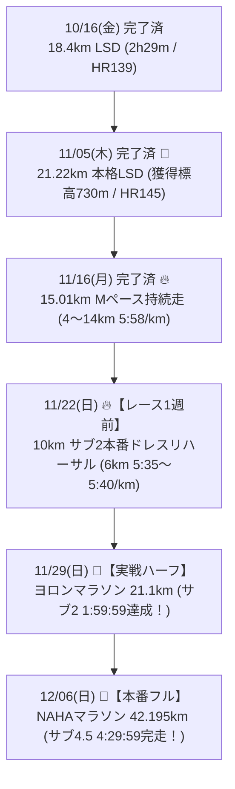

# 🔥 NAHAマラソン（サブ4.5）＆ ヨロンマラソン（サブ2）攻略：最適化トレーニング計画（完成版）

本ドキュメントは、**2026年11月29日（日）ヨロンマラソン（ハーフ：サブ2目標）** および **2026年12月06日（日）NAHAマラソン（フル：サブ4.5目標）** の達成を目指すランナーのための【心拍数低下・エコノミー特化型プログラム（完成版）】です。

ランナーの「4:08/kmを出せる高いスピードの天井」を前提に、**「長距離LSDによる心肥大・毛細血管拡張」**、**「LT走による乳酸クリアランス向上」**、そして**「ジョグ後の流しによるランニングエコノミー改善（バネ強化）」**を統合した最高密度のメニュー設計です。

---

## 🎯 固定ターゲットタイム
* **🔥 主目標**: **10km 50分00秒突破【サブ50達成！】**（平均 4:55〜5:00/km・想定平均心拍 175〜180bpm・実測HRmax 196bpm）
* **🏁 ヨロンマラソン（11/29 ハーフ）**: **1時間59分59秒【サブ2達成！】**（平均 5:41/km・巡航 5:35〜5:40/km・想定心拍 165〜172bpm）
* **👑 NAHAマラソン（12/06 フル）**: **4時間29分59秒【サブ4.5達成！】**（平均 6:23/km・巡航 6:18〜6:23/km・想定心拍 150〜156bpm）

---

## 🧭 心拍数を下げるための3大改善ルール（追加・強化点）

1. **【ジョグの最後に「流し（100m×2〜3本）」を常設化】（エコノミー改善）**:
   * LSDやジョグの後に、平地や緩やかな上り坂で 100m の流し（80〜90%の力で脱力・大きなフォーム）を2〜3本サッと入れます。
   * これにより筋腱のバネ（伸張反射）が目覚め、**日常のジョグや本番ペースでの酸素消費量（VO2）が減り、心拍数が自然に低下**します。
2. **【平日のLT走は「適正LTゾーン（168〜174bpm）」を管理】**:
   * 最大心拍数196bpmに合わせ、**「心拍数を 168〜174 bpm（上限目安176bpm）に収める」ことを最優先**にします。
   * 176bpmを超えそうになったら少しペースを落とすことで、乳酸を溜めずに「乳酸クリアランス酵素」を最大効率で増やします。
3. **【LSDでの「給水・補給プロトコル」の実践】（心拍ドリフト防止）**:
   * 脱水による血液濃縮（心拍数+5〜10bpmの上昇）を防ぐため、**5kmごとの給水と、10km地点でのエナジージェル摂取**を練習時からルーティン化します。

---

## 📅 週単位ロング走スタック（段階的距離ステップ）

---

## 🏃 各週の詳細スケジュール（改善版）

### Week 1：10/26（月）〜 11/01（日）【フル6週前 / ハーフ5週前】
* **テーマ**: 刺激注入完了 ＆ 遠征でのアクティブレスト
* **スケジュール**:
  * 10/26（月）: **【完了】8km ビルドアップ走**（ピッチ178spm固定・ラスト4:58/km 🔥）
  * 10/27（火）〜 28（水）: 完全休養（超回復・フェリー予約）
  * 10/29（木）夕方: **🌟【改善】6km 有酸素イージージョグ（Zone 2 / 130〜145bpm） ＋ 流し100m×2本**
    * ※ジョグ後に流しを2本入れ、翌日からの遠征前に脚のバネを刺激して整える。
  * 10/30（金）〜 11/01（日）: **遠征滞在（ラン完全オフ・積極的休養）**

---

### Week 2：11/02（月）〜 11/08（日）【フル5週前 / ハーフ4週前】
* **テーマ**: **祝日LT巡航走 ＆ 21.2km 本格ハーフ走破（有酸素エンジン爆発強化）**
* **スケジュール**:
  * 11/02（月）: 移動日（完全休養）
  * 11/03（火・祝）: **【完了】8.32km LTテンポ巡航走**（5km 5:28/km・HR171bpm・ラスト流し3:32/km 🔥）
  * 11/04（水）: 【完了】完全休養（中1日リカバリー）
  * 11/05（木）夕方: **🌟【完了】21.22km 本格LSD（2時間41分・平均心拍145bpm Zone 2死守 ＆ ラスト流し3:55/km 👑）**
    * 雨上がりの奥武山公園周回で21.22kmを走破。終始心拍145bpm前後に抑え込む驚異的なペース制御を完遂。
  * 11/06（金）〜 11/08（日）: **遠征滞在（ラン完全オフ・3日間の特大超回復）**

---

### Week 3：11/09（月）〜 11/15（日）【フル4週前 / ハーフ3週前】🔥【実戦スピード＆Mペース強化週】
* **テーマ**: **平地1kmインターバルでVO2max覚醒 ＆ フル目標巡航ペース（6:00〜6:15/km）完全定着**
* **スケジュール**:
  * 11/09（月）: **完全休養（96時間超回復の完了 ＆ 週末移動疲労リセット）**
  * 11/10（火）夕方: **【完了】🔥 10.01km 1km交代走（疾走4:38 ➔ 4:29 ➔ 最速4:20/km！つなぎ5分台、全体5:20/km・HR167・Max187）**
    * 疾走区間で想定（4:55）を圧倒する驚異のスピードと推進力を発揮。つなぎジョグでも5分台を維持し、乳酸シャトル機構とVO2maxが覚醒！動的判定【レベルA：絶好調】を達成。
  * 11/12（木）夕方: **【完了】6.35km 有酸素イージージョグ ＋ 流し**（平均7:05/km・HR144）
  * 11/13（金）: 移動日（完全休養）
  * 11/14（土）: 完全休養（ストレッチのみ）
  * 11/15（日）: **完全休養（脚の張り・違和感ケアのため翌日へ延期）**

---

### Week 4：11/16（月）〜 11/22（日）【フル3週前 / ハーフ2週前】
* **テーマ**: **右膝を100%守り抜きながら、「フルサブ4.5（6:20/km）」と「ハーフサブ2（5:35〜5:40/km）」の2大巡航リズムを身体に完全定着させる**
* **スケジュール**:
  * 11/16（月）夕方: **【完了】15.01km Mペース持続走**（4〜14km平均 5:58/km・HR163・ラスト1km流し 5:13/km。13kmで右膝上の違和感が出たため15kmで安全切り上げ）
  * 11/17（火）: **【完了】完全休養**（Mペース走の超回復 ＆ 雨天休養）
  * 11/18（水）: **完全休養**（夜間の雨天・北風強風予報 ＆ 右膝上ケア・72時間超回復完了）
  * 11/19（木）夕方: **【完了】6.02km ビルドアップ走（平均 5:28/km・HR167・Max185 / Lap4 5:14 ➔ Lap5 4:40/km）**
    * ※右膝上の違和感を感じたため、無理に8kmへ延ばさず、後半に4:40/kmのスピード刺激を入れた上で6.02km（32分54秒）で安全に切り上げ。翌金・土の48時間完全オフで回復へ繋ぐ。
  * 11/20（金）〜 11/21（土）: 遠征滞在（ラン完全オフ・積極的休養 / 48時間超回復）
  * 11/22（日）: **【完了】完全休養**（予定調整によりランオフ・86時間超回復へ延長）

---

### Week 5：11/23（月・祝）〜 11/29（日）【ヨロンハーフ本番週 / フル1週前】
* **テーマ**: **🏁 悪天候を賢くかわして完全ピーキング（TSB +2.1） ➔ ヨロンマラソン【サブ2（1:59:59）完走】！**
* **スケジュール**:
  * 11/23（月・祝）午前: **【完了】🔥 10.01km サブ2本番ドレスリハーサル走（55:23 / 平均 5:32/km・平均HR 165 / Max 181）**
    * 1〜3kmを5:54/km（HR154）で入り、4〜9kmを目標より速い **5:27/km（HR168）** で安定巡航、ラスト1kmを **4:52/km** で締めくくる完璧なネガティブスプリットを右膝無傷で完遂！
  * 11/24（火）: **完全休養（雨天回避 ＆ 48時間超回復）**
  * 11/25（水）夜: **🌱 3〜4km 超イージージョグ（6:25〜6:40/km・Zone 1〜2） ＋ 流し100m×1〜2本 ➔ プールリカバリー（500m前後 / 20〜25分）**
    * ※曇り・降水20%で今週最も安定した平日枠。合計運動時間を45〜50分以内に抑え、軽いジョグ＋流しの後に着地衝撃ゼロのゆったり水泳で疲労を抜く最終調整（23日の10kmで刺激入れは完了しているため疲労を残さない）。
  * 11/26（木）夕方: **原則・完全休養（雨予報90%回避・中3日ピーキング）**
    * ※最新予報で木曜の降水確率が90%へ上昇したため、無理に走らず休養を基本として疲労抜きを徹底（夕方晴れ間が出た場合のみ、3〜4kmの超イージー＋流し1本に留める）。
  * 11/27（金）: **原則・完全休養**
    * ※翌朝移動に向けた荷造り・睡眠優先・水分・電解質補給＆カーボチャージ。
  * 11/28（土）: **🚢 与論島移動（07:00発 ➔ 11:50着）・前日完全休養**
    * ※与論到着後、前日受付・コース下見・カーボローディング・水分確保・早め就寝。
  * 11/29（日）: **🏁【ヨロンマラソン（ハーフ・21.0975km）本番】**
    * **固定目標タイム: 1時間59分59秒（サブ2達成！ / 平均 5:41/km）**
    * **本番ペーシング戦略（1:59:59突破の黄金レシピ）**:
      * **0〜3km（アップ区間）**: `5:50〜5:55/km`（計17分40秒・心拍155〜162bpm）で関節と心肺を温めながらリラックスして入る。
      * **4〜18km（巡航区間 15km）**: コースの起伏に対し「ペース一定」ではなく **「平均 5:38〜5:40/km・心拍165〜172bpmキャップ」** で巡航（平地5:33〜5:37/km、上り坂は無理せず5:48〜5:55/kmへ落として前ももと心肺を温存、下り坂はブレーキをかけず骨盤真下着地で5:25〜5:30/kmへ自然に回収）。
      * **19〜21.1km（フィニッシュ 3.1km）**: 平均 `5:32〜5:35/km`（心拍172〜178bpm）で押し切り、**1時間59分40秒（サブ2達成！）** でゴール！
    * ⚠️ 走後30分以内に糖質＋タンパク質補給、右膝・前もものアイシング、水分補給を徹底（翌週フルへのダメージ最小化）。

---

### Week 6：11/30（月）〜 12/06（日）【NAHAマラソン本番週！】
* **テーマ**: **🎉 完全超回復からの栄光：NAHAマラソン【サブ4.5（4:29:59）完走】！**
* **スケジュール**:
  * 11/30（月）: **🚢 与論島 ➔ 那覇移動（14:10発 ➔ 19:00着）**（完全休養・着圧ケア・水分補給）
  * 12/01（火）: 完全休養（超回復・温冷交代浴・筋膜リリース）
  * 12/02（水）夕方: **3km 超スロージョグ**（完全脱力・血流促進のみ / 右膝や脚の張りが少しでもあればウォーキングまたは完全休養に変更）
  * 12/04（金）夕方: **2km ジョグ ＋ 100m流し1本**（心拍を少し起こすのみ。※疲労感・筋肉痛が少しでも残っていれば**走らず完全休養**へ切り替え）
  * 12/05（土）: 完全休養（カーボローディング・水分・電解質補給）
  * 12/06（日）: **🎉【NAHAマラソン（フル・42.195km）本番】**
    * **固定目標タイム: 4時間29分59秒（サブ4.5達成！ / 平均 6:23/km）**
    * **本番ペーシング戦略（4:29:59突破の黄金レシピ）**:
      * **0〜3km（スタート渋滞＆アップ区間）**: `6:40〜6:45/km`（計20分10秒・心拍142〜148bpm）で焦らず入る。
      * **4〜21.1km（前半・平和祈念公園までの上り区間）**: 平均 **`6:22〜6:25/km`**（中間点 約2時間15分30秒・**心拍150〜156bpmキャップ厳守**）。上り坂は `6:30〜6:35/km` に落としてでも心拍156bpm以下を守り抜く。
      * **21.1〜35km（後半中盤・糸満への下り〜平坦）**: 平均 **`6:15〜6:20/km`**（心拍152〜158bpm）で省エネ回収。
      * **36〜42.2km（終盤・奥武山公園へ）**: 平均 **`6:20〜6:25/km`** で粘り切り、**4時間28分30秒〜4時間29分59秒（サブ4.5達成！）** でゴール！

---

### 🔄 天候・体調ブレ時の微調整ルール（Week 4〜5）
* **11/19（木）の最初の3kmアップで右膝上に張り・違和感を感じた場合**:
  * サブ2ペース（5:35〜5:40/km）へは上げず、そのまま **6〜7kmのサブ4.5ペース〜イージージョグ（6:20〜6:35/km）** で安全に終了し、11/22（日）の10kmドレスリハーサル走へ備える。
* **11/24（火）〜 11/25（水）ともに夜間雨が続く場合**:
  * レース週の雨天ランは一切不要。11/24（火）・11/25（水）を連続休養とし、雨が上がる **11/26（木）夕方の4km最終刺激入れ（3kmアップ＋1km 5:35〜5:40/km＋流し1〜2本）の1回のみ** に集約して完全フレッシュな脚で与論島へ乗り込む。
