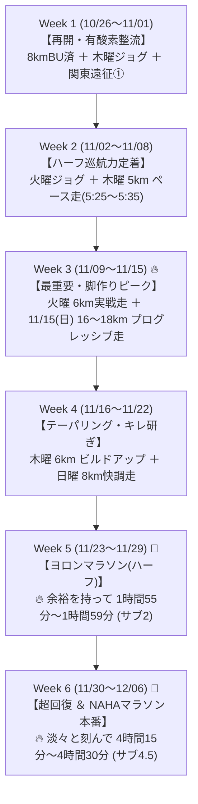

# 🔥 NAHAマラソン（サブ4.5）＆ ヨロンマラソン（サブ2）攻略：改訂版トレーニング計画

本ドキュメントは、**2026年11月29日（日）ヨロンマラソン（ハーフ：サブ2目標）** および **2026年12月06日（日）NAHAマラソン（フル：サブ4.5目標）** の達成を目指すランナーのための【最適化・改訂版トレーニング計画】です。

過去ログで実証された**「4:08/kmを叩き出せるスピードの天井」**および**「普段は余裕を持ってコントロールして走っている」**という真の実力を前提に、**「怪我リスクの高い無理なインターバル走」を排除し、「本番巡航ペース（5:30/km & 6:15/km）のエコノミー向上と着地筋持久力」に全集中**するプログラムへと見直しました。

---

## 🎯 ターゲットタイム
* **🏁 ヨロンマラソン（11/29 ハーフ）**: **1時間55分 〜 1時間59分【サブ2達成！】**（平均 5:27〜5:38/km）
* **👑 NAHAマラソン（12/06 フル）**: **4時間15分 〜 4時間30分【サブ4.5達成！】**（平均 6:00〜6:25/km）

---

## 🧭 見直しの3大基本方針
1. **怪我リスクの高い急加速・インターバルを完全排除**:
   * すでに4:08/kmを出せる心肺・スピードの天井があるため、故障リスクを高める1000mインターバル等は行いません。
   * スピード刺激は「3kmアップ後の軽快な流し（100m×2〜3本）」程度で神経系を整えるだけで十分です。
2. **「本番レースペース（5:30/km & 6:15/km）の省エネ化」に特化**:
   * ハーフ目標（5:30/km）とフル目標（6:15/km）を、ピッチ178spmの最小エネルギーで淡々と刻む「巡航エコノミー」を鍛えます。
3. **週2〜3日のメリハリと関節・腱の保護**:
   * 大人の腱・靭帯・骨膜の修復サイクル（中1〜3日）を厳守し、関東遠征中（10/30〜11/2、11/6〜11/8等）は完全アクティブレストとして脚を休めます。

---

## 📅 週単位ロードマップ概要（全6週間）

---

## 🏃 各週の詳細スケジュール（改訂版）

### Week 1：10/26（月）〜 11/01（日）【フル6週前 / ハーフ5週前】
* **テーマ**: フォーム確認 ＆ 関東遠征でのアクティブレスト
* **スケジュール**:
  * 10/26（月）: **【完了】8km ビルドアップ走**（ピッチ178spm固定・ラスト4:58/km 🔥）
  * 10/27（火）〜 28（水）: 完全休養（超回復・フェリー予約）
  * 10/29（木）夕方: **6〜7km 有酸素イージージョグ**（3kmアップ ＋ 3〜4km Zone 2 / 130〜145bpm）
    * ※ペースは追わず、出張前の身体ほぐしに専念。
  * 10/30（金）〜 11/01（日）: **関東滞在（ラン完全オフ・ビールフェス満喫 🍻）**

---

### Week 2：11/02（月）〜 11/08（日）【フル5週前 / ハーフ4週前】
* **テーマ**: **ハーフ目標ペース（5:30/km）の「楽な巡航感覚」を作る**
* **スケジュール**:
  * 11/02（月）: 関東滞在 → 深夜22:35 那覇帰着
  * 11/03（火・祝）夕方: **帰沖リカバリージョグ 5〜6km**（3kmアップ ＋ 2〜3kmゆるジョグ）
  * 11/04（水）: 完全休養
  * 11/05（木）夕方: **🔥【ポイント走】3kmアップ ＋ 5km レースペース巡航（5:25〜5:35/km） ＋ 1kmダウン（計9km）**
    * 狙い: 追い込むのではなく、「このペースなら何kmでも行けそう」という脱力したフォームを体感する。
  * 11/06（金）〜 11/08（日）: **関東滞在（ラン完全オフ・ちゃんぷる〜フェス＆同窓会 🍻）**

---

### Week 3：11/09（月）〜 11/15（日）【フル4週前 / ハーフ3週前】🔥【最重要強化週】
* **テーマ**: **NAHAフル完走を支える「脚の耐着地衝撃性」の完成**
* ※週末に関東遠征がなく、那覇でじっくり時間を確保できる最大の山場！
* **スケジュール**:
  * 11/09（月）: 完全休養
  * 11/10（火）夕方: **3kmアップ ＋ 5km 快調走（5:20〜5:30/km） ＋ 最後に流し2本（計9km）**
    * ※急激なインターバルは廃止し、本番ペースの再現性を高める。
  * 11/12（木）夕方: **6km 有酸素イージージョグ**（3kmアップ ＋ 3km Zone 2）
  * 11/13（金）: 東京日帰り（移動日・完全休養）
  * 11/14（土）: 完全休養（ストレッチのみ）
  * 11/15（日）朝: **🌟【最重要ポイント走】16〜18km プログレッシブ（段階加速）ロング走**
    * 構成: **3kmアップ ＋ 8km 有酸素走（7:15〜7:45/km） ＋ 後半5〜6kmをMペース（6:15〜6:30/km）へ自然に引き上げ！**
    * 狙い: 「疲れてきた後半にフルの巡航ペースを淡々と維持する」実戦的な筋持久力を養う。

---

### Week 4：11/16（月）〜 11/22（日）【フル3週前 / ハーフ2週前】
* **テーマ**: 距離を落として疲労を抜き、筋膜と腱の弾力を取り戻す
* **スケジュール**:
  * 11/16（月）: 完全休養（ロング走の疲労抜き）
  * 11/17（火）: **5〜6km 疲労抜きリカバリージョグ**
  * 11/19（木）: **7〜8km 軽快ビルドアップ**（3kmアップ ＋ 3〜4km 5:25/km ＋ 1kmダウン）
  * 11/20（金）〜 11/21（土）: 関東滞在（ラン完全オフ・土曜夜帰沖）
  * 11/22（日）: **8km イージージョグ**（3kmアップ ＋ 5km 気持ちいいペース）

---

### Week 5：11/23（月・祝）〜 11/29（日）【ヨロンハーフ本番週 / フル1週前】
* **テーマ**: **🏁 ヨロンマラソンで【サブ2（1時間55分〜1時間59分）】を無理なく達成！**
* **スケジュール**:
  * 11/23（月・祝）: 完全休養（那覇こども大綱挽まつり）
  * 11/24（火）: **5km 調整ジョグ ＋ 流し2本**（3kmアップ ＋ 2km軽快走）
  * 11/26（木）: **3kmアップ ＋ 1kmだけレースペース（5:30/km）確認**
  * 11/27（金）〜 28（土）: ヨロン組来沖・与論島へ移動・リラックス
  * 11/29（日）: **🏁【ヨロンマラソン（ハーフ・21.0975km）本番】**
    * **目標タイム: 1時間55分 〜 1時間59分（サブ2達成！）**
    * **実戦戦略**:
      * 4:08/kmのスピードポテンシャルがあるため、5:30/kmは心肺的に「会話ができる強度」。
      * 前半（0〜10km）は 5:35/km で徹底的に脚を温存。
      * 後半（11〜18km）も 5:30/km で淡々と刻み、ラスト3kmだけ少し上げて 1時間56〜58分でゴール。
      * 👉 **全力を出し切ってバテるのではなく、余裕を持ってサブ2を獲ることで、翌週のNAHAフルへダメージを残さない！**
    * ⚠️ **走後即ケア**: ゴール直後にアイシング、プロテイン・糖質補給、宿で温冷交代浴。

---

### Week 6：11/30（月）〜 12/06（日）【NAHAマラソン本番週！】
* **テーマ**: **🎉 超回復からの大金星：NAHAマラソン【サブ4.5（4時間15分〜4時間30分）】！**
* **スケジュール**:
  * 11/30（月）〜 12/01（火）: 完全休養（ヨロンからの帰還・温冷交代浴・筋膜リリース）
  * 12/02（水）: **3km 超スロージョグ**（完全脱力・脚の軽さを確認）
  * 12/04（金）: **2km ジョグ ＋ 100m流し1本**（心拍を少し起こすのみ）
  * 12/05（土）: 完全休養（カーボローディング・水分・電解質補給）
  * 12/06（日）: **🎉【NAHAマラソン（フル・42.195km）本番】**
    * **目標タイム: 4時間15分 〜 4時間30分（サブ4.5達成！）**
    * **ペース戦略**:
      * 0〜3km: 7:30〜8:00/km（混雑を味方につけて超省エネ）
      * 4〜20km: 6:05〜6:15/km（南部の坂道は心拍150bpm未満キープ）
      * 21〜35km: 6:15〜6:25/km（ヨロンハーフを余裕で走った自信を胸に淡々と巡航）
      * 35〜42.195km: 6:10〜6:20/km（残りの体力を解き放ち、奥武山公園へ歓喜のゴール！）
