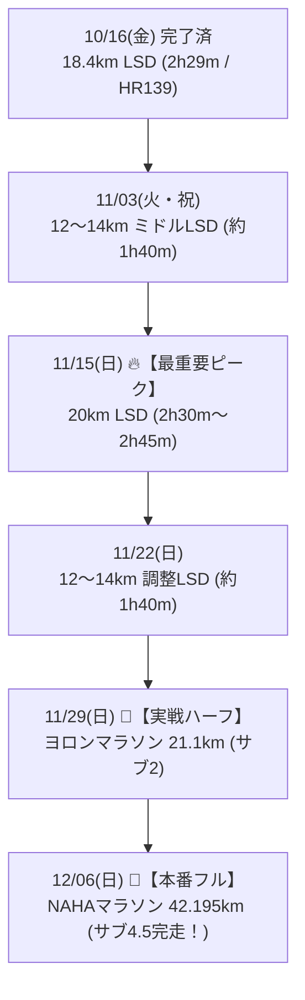

# 🔥 NAHAマラソン（サブ4.5）＆ ヨロンマラソン（サブ2）攻略：LSD・スタミナ特化型トレーニング計画

本ドキュメントは、**2026年11月29日（日）ヨロンマラソン（ハーフ：サブ2目標）** および **2026年12月06日（日）NAHAマラソン（フル：サブ4.5目標）** の達成を目指すランナーのための【LSD・脚作り特化型プログラム】です。

ランナーの「4:08/kmを出せる高いスピードの天井」を前提に、フルマラソン完走・サブ4.5達成の最大の鍵である**「長距離LSDによる毛細血管拡張・脂質代謝向上・脚の耐着地衝撃性」**を毎週段階的に積み上げる構成に全面刷新しました。

---

## 🎯 ターゲットタイム
* **🏁 ヨロンマラソン（11/29 ハーフ）**: **1時間55分 〜 1時間59分【サブ2達成！】**（平均 5:27〜5:38/km）
* **👑 NAHAマラソン（12/06 フル）**: **4時間15分 〜 4時間30分【サブ4.5達成！】**（平均 6:00〜6:25/km）

---

## 🧭 なぜ「長距離LSD特化」が最強の戦略なのか？
1. **スピードはすでに合格ラインを大幅に突破している**:
   * 4:08/kmの出力を誇るため、フル巡航（6:00〜6:25/km）やハーフ巡航（5:27〜5:38/km）のスピード自体は極めて楽な領域。
2. **フルマラソンの真の壁は「着地衝撃」と「エネルギー枯渇」**:
   * 30km以降に止まってしまう原因は心肺ではなく、**「前もも（大腿四頭筋）の筋破壊」**と**「筋グリコーゲン枯渇（糖切れ）」**。
   * これを解決できる唯一の練習が、**「Zone 2（130〜145bpm）で2時間〜2時間半以上動き続けるLSD」**。
3. **関東遠征の合間を縫った「週末・祝日LSDスタック」**:
   * 祝日（11/3火祝）や那覇滞在の週末（11/15日、11/22日）をフル活用し、本番までほぼ毎週「12〜21km」のロング距離を踏む。

---

## 📅 週単位ロング走スタック（段階的距離ステップ）

---

## 🏃 各週の詳細スケジュール（LSD特化版）

### Week 1：10/26（月）〜 11/01（日）【フル6週前 / ハーフ5週前】
* **テーマ**: 刺激注入完了 ＆ 関東遠征でのアクティブレスト
* **スケジュール**:
  * 10/26（月）: **【完了】8km ビルドアップ走**（ピッチ178spm固定・ラスト4:58/km 🔥）
  * 10/27（火）〜 28（水）: 完全休養（超回復・フェリー予約）
  * 10/29（木）夕方: **6〜7km 有酸素イージージョグ**（3kmアップ ＋ 3〜4km Zone 2 / 130〜145bpm）
  * 10/30（金）〜 11/01（日）: **関東滞在（ラン完全オフ・ビールフェス満喫 🍻）**

---

### Week 2：11/02（月）〜 11/08（日）【フル5週前 / ハーフ4週前】
* **テーマ**: **祝日を活用した「12〜14km ミドルLSD」**
* **スケジュール**:
  * 11/02（月）: 関東滞在 → 深夜22:35 那覇帰着
  * 11/03（火・祝）午前または夕方: **🌟【ロング走①】12〜14km LSD（1時間40分〜1時間55分）**
    * 構成: 3kmアップ ＋ 9〜11km Zone 2（7:30〜8:00/km、心拍135〜145bpm）
    * 狙い: 関東で休めた脚に、長時間の有酸素刺激を再注入。
  * 11/04（水）: 完全休養
  * 11/05（木）夕方: **3kmアップ ＋ 4〜5km 快調走（5:30/km） ＋ 1kmダウン（計8〜9km）**
  * 11/06（金）〜 11/08（日）: **関東滞在（ラン完全オフ・ちゃんぷる〜フェス＆同窓会 🍻）**

---

### Week 3：11/09（月）〜 11/15（日）【フル4週前 / ハーフ3週前】🔥【最重要脚作り週】
* **テーマ**: **NAHAフル完走を決定づける「20km LSD（最長距離ピーク）」**
* ※週末に関東遠征がなく、那覇でじっくり時間を確保できる最大の山場！
* **スケジュール**:
  * 11/09（月）: 完全休養
  * 11/10（火）夕方: **3kmアップ ＋ 5km ペース走（5:30/km） ＋ 1kmダウン（計9km）**
  * 11/12（木）夕方: **5〜6km 有酸素イージージョグ**
  * 11/13（金）: 東京日帰り（移動日・完全休養）
  * 11/14（土）: 完全休養（ストレッチのみ）
  * 11/15（日）早朝: **🌟【最重要ポイント走】20km LSD（時間耐久 2時間30分〜2時間45分）**
    * ペース目安: **7:30〜8:00/km（心拍130〜145bpm Zone 2を徹底死守）**
    * 狙い: 42kmに耐えうる毛細血管網の最大拡張と、体脂肪をエネルギーに変える「脂質代謝スイッチ」の完全定着。給水・補給ジェルの実戦練習も行う。

---

### Week 4：11/16（月）〜 11/22（日）【フル3週前 / ハーフ2週前】
* **テーマ**: **ハーフ1週前の「12〜14km 調整LSD」**
* **スケジュール**:
  * 11/16（月）: 完全休養（20km LSDの疲労抜き）
  * 11/17（火）: **5〜6km 疲労抜きリカバリージョグ**
  * 11/19（木）: **3kmアップ ＋ 4km 快調走（5:25/km） ＋ 1kmダウン（計8km）**
  * 11/20（金）〜 11/21（土）: 関東滞在（土曜夜20:05帰沖・ラン完全オフ）
  * 11/22（日）午前または夕方: **🌟【ロング走③】12〜14km LSD（7:30〜8:00/km）**
    * 狙い: 翌週のヨロンハーフに向けて脚のスタミナ感をキープしつつ、疲労を残さない長さにコントロール。

---

### Week 5：11/23（月・祝）〜 11/29（日）【ヨロンハーフ本番週 / フル1週前】
* **テーマ**: **🏁 ヨロンマラソン（21.1km）を「極上の実戦ロング走」としてサブ2完走！**
* **スケジュール**:
  * 11/23（月・祝）: 完全休養（那覇こども大綱挽まつり）
  * 11/24（火）: **5km 調整ジョグ ＋ 流し2本**
  * 11/26（木）: **3kmアップ ＋ 1kmだけレースペース（5:30/km）確認**
  * 11/27（金）〜 28（土）: ヨロン組来沖・与論島へ移動・リラックス
  * 11/29（日）: **🏁【ヨロンマラソン（ハーフ・21.0975km）本番】**
    * **目標タイム: 1時間55分 〜 1時間59分（サブ2達成！）**
    * 前半5:35/km温存 → 後半5:30/km巡航 → 余裕を持ってゴール。
    * 👉 **このハーフ自体が、翌週のNAHAフル（42km）に向けた「最後の完璧な21km実戦ロング走」になります！**
    * ⚠️ 走後即アイシング・プロテイン・糖質補給・温冷交代浴。

---

### Week 6：11/30（月）〜 12/06（日）【NAHAマラソン本番週！】
* **テーマ**: **🎉 完全超回復からの栄光：NAHAマラソン【サブ4.5完走】！**
* **スケジュール**:
  * 11/30（月）〜 12/01（火）: 完全休養（超回復・温冷交代浴・筋膜リリース）
  * 12/02（水）: **3km 超スロージョグ**（完全脱力）
  * 12/04（金）: **2km ジョグ ＋ 100m流し1本**（心拍を少し起こすのみ）
  * 12/05（土）: 完全休養（カーボローディング・水分・電解質補給）
  * 12/06（日）: **🎉【NAHAマラソン（フル・42.195km）本番】**
    * **目標タイム: 4時間15分 〜 4時間30分（サブ4.5達成！）**
    * 10/16、11/3、11/15、11/22、11/29と積み重ねてきた圧倒的な「脚の耐久性」が、30km以降の南部路で爆発的な強さを発揮します！
